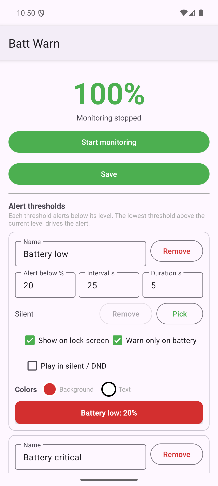
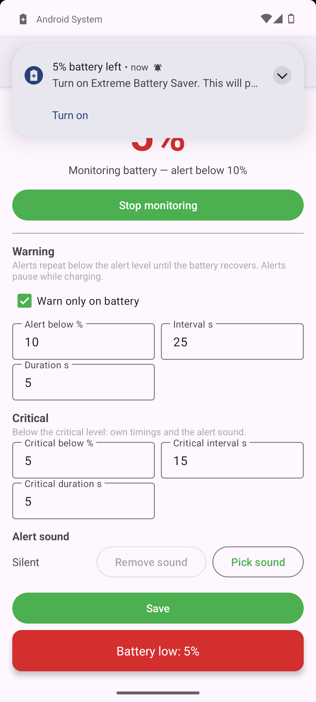
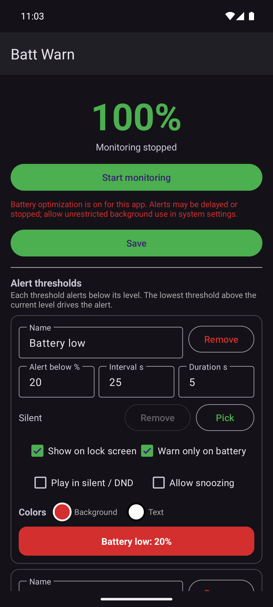
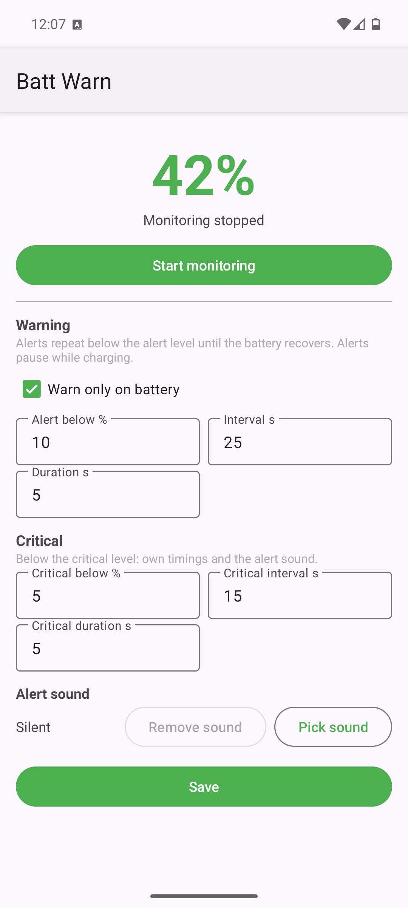
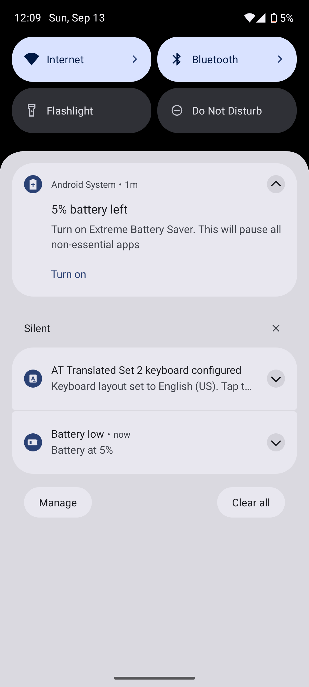
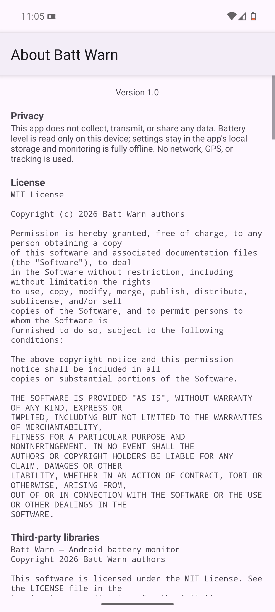
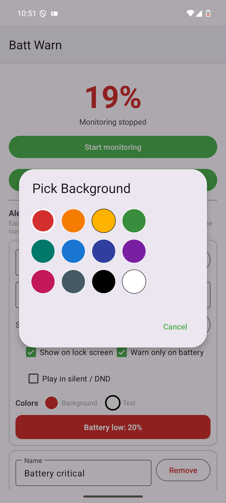
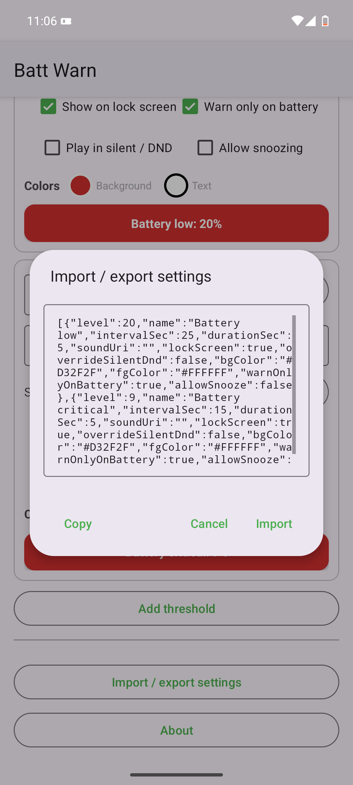

# Batt Warn

[](LICENSE)

An Android battery monitor for Android 9+ that runs as a foreground service and
alerts before the battery gets too low.

<p align="center">
  
  
  
</p>

## Features

- Event-driven battery monitoring with no idle polling.
- User-configurable list of thresholds; each threshold has its own level, name,
  sound, quiet interval, banner duration, lock-screen display, silent/DND
  override, background/text colors, and a per-threshold **Warn only on
  battery** mode that pauses alerts while charging.
- Every threshold can play a user-picked notification sound.
- Floating bottom banner when “Display over other apps” is enabled.
- Full-screen lock-screen warning (default on) while the display is already on.
- Notification fallback with the current battery percentage.
- Starts after boot and package replacement.
- Import / export of the threshold config as JSON from the main screen.
- Compact light/dark UI with live battery updates, plus an in-app About screen
  showing the license texts and privacy statement.

Screenshots live in [docs/screenshots](docs/screenshots/): the main screen in
light and dark mode, the low-battery state, the floating banner, the
notification, the About/license screen, the lock-screen warning, the color
picker, and the settings import/export dialog.

<p align="center">
  
  
  
  
  
  
</p>

## Quick start

The complete development environment is provided by Nix:

```sh
nix-shell
make build       # app/build/outputs/apk/debug/app-debug.apk
make install     # build and install to a connected device
make run         # install and launch MainActivity
```

For emulator development:

```sh
make test-boot   # reboot the API 35 AVD and run instrumented tests
make test        # run tests against an already-running emulator
make avd-clean   # stop the emulator and delete the AVD
make emulator-clean # uninstall app + test APK, stop emulator, delete AVD data
make soak        # long-running randomized soak (default 24 h) -> /tmp/battwarn-soak.log
```

`make test-boot` (and `make emulator`/`make screenshots`) create the AVD on
demand if it is missing — system image
`system-images;android-35;google_apis_playstore;x86_64`, device `pixel_6` —
printing a notice when they do, then boot and wait (bounded) for Android;
`make test-boot` reboots a reused emulator for a clean battery state.
`make avd-clean` stops the emulator and removes the AVD again (`make clean-all`
pairs it with Gradle `clean` through `emulator-clean`).
`make emulator-clean` additionally uninstalls the app and
the test APK from a live emulator first and sweeps any leftover AVD image/data
directory; `make uninstall` removes both the app and the test APK.
`make soak` runs a separate long (default 24 h, `MINUTES=`) randomized
battery soak whose checks and live logcat all go to `/tmp/battwarn-soak.log`
(`LOG=`) for later debugging.
The emulator log is `/tmp/battwarn-emulator.log`; its tail
is printed if boot fails.
`make test` streams Gradle failures and finishes with a per-test PASS/FAIL
summary. See [docs/testing.md](docs/testing.md) for the full workflow.

## Permissions

The app asks for or uses these Android permissions:

- `RECEIVE_BOOT_COMPLETED` — restart monitoring after boot or app replacement.
- `FOREGROUND_SERVICE` and `FOREGROUND_SERVICE_SPECIAL_USE` — keep monitoring
  reliably in the background.
- `POST_NOTIFICATIONS` — show the foreground-service notification on Android 13+.
- `SYSTEM_ALERT_WINDOW` — show the optional banner above other apps and the
  full-screen lock-screen warning.
- Battery-optimization exemption — requested from the Start flow to reduce Doze
  delays.

Android force-stop is a system-level exception: after a user force-stops an app,
Android suppresses its boot receiver until the app is opened again.

## Alert behavior

Each threshold in the list alerts below its level. The threshold that drives an
alert is the **lowest level above the current battery percentage** — the most
severe applicable tier. With thresholds at 20% and 9%, for example: at 15% the
20% tier applies, at 8% the 9% tier applies, and at or above 20% the service
stays idle. A threshold can carry an optional name (shown before the percentage
and as the notification title), a picked sound, its own quiet interval and
banner duration, a lock-screen toggle, a silent/DND override, and its own
background/text colors for the banner and the lock-screen alert.

The interval is a quiet pause measured **after** the previous banner closes,
whether it auto-dismissed or was tapped. If the overlay permission is absent,
the notification remains available (tapping it opens the app) and the fallback
cycle is scheduled from the previous alert start.

With **Show on lock screen** enabled for a threshold (default) and the overlay
permission granted, an alert that fires while the device is locked and the
display is already on is drawn full-screen over the lock screen in that
threshold's colors. The screen is never woken; with the display off the
notification remains the surface. The platform only allows the background
service to raise that full-screen activity because the overlay permission is
granted.

The **active** threshold's **Warn only on battery** flag decides whether
warnings pause while charging, so each tier can warn (or stay silent) while
plugged in. The foreground notification continues to show the current level
while charging.

See [docs/behavior.md](docs/behavior.md) and [docs/architecture.md](docs/architecture.md)
for details.

## Battery usage

While above every threshold, the service does not poll or hold a wake lock. It
listens for `ACTION_BATTERY_CHANGED`. Active monitoring only cycles while below
the highest threshold, with one inexact doze backstop alarm per pending cycle;
the app uses no network, GPS, or other periodic background work.

A liveness watchdog — one coarse exact alarm about every 15 minutes while
monitoring is enabled — keeps monitoring alive automatically, with **no user
interaction**: it restarts the service if the system kills it, and while the
service lives each tick re-posts the notification from the actual battery level
and repairs a lost alert cadence, so a low-battery night cannot go silently
unwatched. `USE_EXACT_ALARM` is declared so the exact-alarm right is
auto-granted on Android 13+ (Android 14+ no longer grants the ordinary exact
permission by default). An explicit **Stop** cancels the watchdog, and it never
resurrects a monitor the user stopped. The watchdog re-arms before it acts, a
live service always keeps a fresh alarm, and **opening the app self-heals an
enabled-but-dead monitor** — so even a force-stop-style kill is repaired on the
next app launch without pressing Start. The Start flow also asks for the
battery-optimization exemption; the main screen warns while the app is still
battery-restricted.

## Project status

- Minimum SDK: 28 (Android 9)
- Target/compile SDK: 35
- Gradle: 8.14.4
- JDK: 17
- Instrumented tests: 67 (plus 12 JVM unit tests)

## Documentation

- [Architecture](docs/architecture.md)
- [Behavior and settings](docs/behavior.md)
- [Testing and development](docs/testing.md)

## Third-party libraries

The app uses the following libraries (all declared in
[app/build.gradle.kts](app/build.gradle.kts)). Bundled runtime libraries are
shipped inside the APK; the rest are build/test-only.

Runtime (bundled in the APK):

- [AndroidX](https://developer.android.com/jetpack/androidx) — `androidx.core:core-ktx 1.15.0`,
  `androidx.appcompat:appcompat 1.7.0`, `androidx.constraintlayout:constraintlayout 2.2.0`,
  `androidx.databinding:viewbinding 8.10.1`, and their transitive AndroidX
  dependencies — Apache-2.0
- [Material Components for Android](https://github.com/material-components/material-components-android) —
  `com.google.android.material:material 1.12.0` — Apache-2.0
- [Kotlin standard library](https://github.com/JetBrains/kotlin) —
  `org.jetbrains.kotlin:kotlin-stdlib 2.2.21` (and its common/jdk7/jdk8 modules) — Apache-2.0
- [Kotlin Coroutines](https://github.com/Kotlin/kotlinx.coroutines) —
  `org.jetbrains.kotlinx:kotlinx-coroutines-android` / `kotlinx-coroutines-core 1.6.4` — Apache-2.0
- [Guava listenablefuture](https://github.com/google/guava) —
  `com.google.guava:listenablefuture 1.0` — Apache-2.0
- [Error Prone annotations](https://github.com/google/error-prone) —
  `com.google.errorprone:error_prone_annotations 2.15.0` — Apache-2.0
- [JetBrains annotations](https://github.com/JetBrains/java-annotations) —
  `org.jetbrains:annotations 13.0` — Apache-2.0

Build/test-only:

- [junit:junit 4.13.2](https://github.com/junit-team/junit4) — EPL-1.0
- [org.json:json 20240303](https://github.com/stleary/JSON-java) — JSON license (build-time unit tests only)
- [androidx.test:runner 1.6.2](https://developer.android.com/jetpack/androidx) — Apache-2.0
- [androidx.test:rules 1.6.1](https://developer.android.com/jetpack/androidx) — Apache-2.0
- [androidx.test:core-ktx 1.6.1](https://developer.android.com/jetpack/androidx) — Apache-2.0
- [androidx.test.ext:junit 1.2.1](https://developer.android.com/jetpack/androidx) — Apache-2.0
- [androidx.test.espresso:espresso-core 3.6.1](https://developer.android.com/jetpack/androidx) — Apache-2.0

See [NOTICE](NOTICE) for the full third-party notices with copyright lines and
the Apache-2.0 reference.

## License

MIT — see [LICENSE](LICENSE). The app ships the licenses inside it: the
**About** screen in the app shows the MIT license, third-party notices for the
bundled Apache-2.0 libraries, and the privacy statement. The in-app texts are
generated at build time from [LICENSE](LICENSE), [NOTICE](NOTICE), and
[LICENSES/Apache-2.0.txt](LICENSES/Apache-2.0.txt), so each legal text is
maintained in exactly one place.

## AI assistance

This project was developed with the assistance of AI-based coding tools. See
[NOTICE](NOTICE) for the disclosure.
