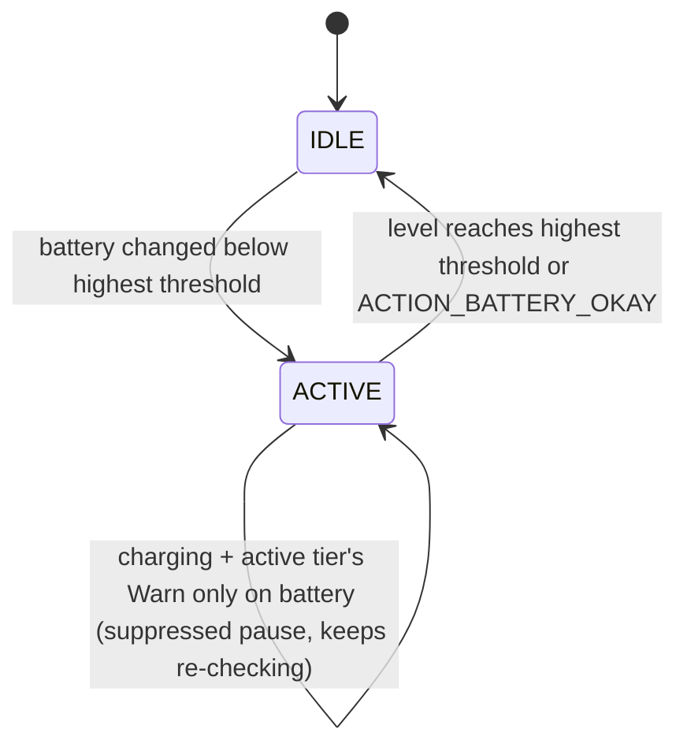
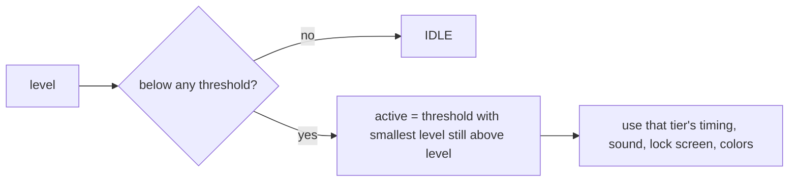

# Architecture

## Components

| Component | Responsibility |
| --- | --- |
| `MainActivity` | Dynamic threshold-list settings UI, live battery percentage, permissions, per-threshold sound picker and color palette |
| `BatteryMonitorService` | Foreground service, battery/power/screen receivers, active-tier selection, notification and alert scheduling, doze backstop |
| `BootReceiver` | Starts the foreground service for `BOOT_COMPLETED` and `MY_PACKAGE_REPLACED` when monitoring is enabled |
| `MonitorWatchdog` | Liveness watchdog: schedules the exact alarm and restarts the service when it has died while enabled |
| `WatchdogReceiver` | Receives the watchdog alarm, re-arms the next tick *first*, then restarts or refreshes the service |
| `AppSettings` | SharedPreferences keys, defaults, threshold-list persistence, monitoring flag, and settings accessors |
| `AlertThreshold` | Data class for one tier (level, name, timings, sound, flags, colors), JSON codec, and pure selection helpers |
| `OverlayAlert` | Bottom `TYPE_APPLICATION_OVERLAY` banner with auto/tap dismissal, tinted per threshold |
| `LockScreenAlertActivity` | Full-screen `showWhenLocked` warning above the keyguard; auto/tap dismissal; colored per threshold |
| `AboutActivity` | In-app legal screen: version, privacy statement, MIT license, third-party notices, and the full Apache-2.0 text |

## State flow

While ACTIVE, the tier is selected on every cycle:

`ACTION_BATTERY_CHANGED` is registered dynamically. It delivers the sticky
current value on registration and subsequent battery/plug-state changes.
`ACTION_POWER_CONNECTED` / `ACTION_POWER_DISCONNECTED` resume or pause the cycle
on plug changes, and `ACTION_SCREEN_ON` polls immediately when the user looks at
the device. All three are registered dynamically while the service runs.

## Liveness watchdog

A foreground service can be killed and may not come back: on Android 12+ a
sticky-restarted service can be refused the foreground promotion, and nothing
else revives it. `MonitorWatchdog` is the safety net — an `AlarmManager` exact
alarm re-armed every ~15 minutes while monitoring is enabled, declared with
`USE_EXACT_ALARM` (+ `SCHEDULE_EXACT_ALARM` for API 31/32) so the exact-alarm
right is auto-granted on Android 13+ and recovery needs no user interaction.
`WatchdogReceiver` runs one tick — it **re-arms the next alarm first, then
acts**, so a tick whose restart action is interrupted (process death, crash in
the freshly started service) still leaves a fresh pending alarm instead of
silently ending the chain:

- service gone + enabled → restart it (holding a pending exact alarm is an
  Android 12+ exemption from the background foreground-service-start
  restriction, so the restart is permitted);
- service alive → send `ACTION_REFRESH`: `BatteryMonitorService` re-posts the
  notification from the sticky battery (bounded staleness even with every
  broadcast lost) and repairs the cadence if no poll is pending.

Two more arms keep the chain unbroken: every successful service start re-arms
the watchdog while enabled (`onStartCommand`, `onDestroy`), so a live service
is never without a pending alarm, and a refused exact-arm falls back to the
slower inexact arm instead of dying silently (`SecurityException`). Opening
MainActivity with monitoring enabled but the service dead also restarts it and
re-arms the watchdog — this is the repair path after anything that cleared the
pending alarm (a force-stop-style kill is the only one left).

`onDestroy` re-arms the watchdog so an unexpected death self-heals; an explicit
Stop cancels it. A refused `startForeground()` inside the service stops it
cleanly — Android enforces a promotion timeout for a service started with
`startForegroundService()` that never successfully promotes — and the
alarm-exempt watchdog revives it within one tick. The persisted
`monitoringEnabled` flag records the
user's intent; boot and the watchdog honor it. See
[docs/behavior.md](behavior.md) for the battery cost.

## Alert scheduling

1. A battery event refreshes the foreground notification immediately.
2. If the level is below the highest threshold, the service enters the active
   tier (`activeThresholdFor`; an unknown level selects no tier).
3. The banner is shown for the tier duration in the tier's colors.
4. When the banner closes, the service waits the tier interval.
5. The next cycle reads settings and battery level again.

`OverlayAlert` reports whether it successfully added its window and invokes a
single dismissal callback for either auto-dismiss or tap. Without overlay
permission, the notification remains the fallback and the interval starts from
the alert attempt.

The next poll is tracked separately from the ACTIVE/IDLE mode, so a lost
dismissal cannot dead-end the cycle: while ACTIVE the service re-arms a poll if
none is pending, and a duration + interval safety net is armed *before* the
banner shows (the real dismissal replaces it with the exact interval). Each
pending poll also arms one inexact `setAndAllowWhileIdle` backstop alarm, so
the cycle survives the CPU sleeping in deep doze. The charging pause and the
unknown-level state are bounded self-re-arming re-checks rather than hard
stops.

While the device is locked with the display already on and the active
threshold's lock-screen flag is set, `LockScreenAlertActivity` is used instead
of the overlay (the overlay cannot show above the keyguard). It reports
dismissal back to the service through an in-app broadcast, so the same
interval rule applies. This path also requires the overlay permission, which is
what permits the background activity start (`BAL_ALLOW_SAW_PERMISSION`).

## Settings

Settings are stored in `battwarn_settings`:

| Key | Default | Meaning |
| --- | ---: | --- |
| `thresholds` | 20%/9% baseline | JSON list of user thresholds; each has `level`, `name`, `intervalSec`, `durationSec`, `soundUri`, `lockScreen`, `overrideSilentDnd`, `bgColor`, `fgColor`, `warnOnlyOnBattery`, `allowSnooze` |
| `monitoringEnabled` | `false` | Persisted Start/Stop intent; honored by the boot receiver and the liveness watchdog |

The fresh-install baseline is a 20% "Battery low" tier and a 9% "Battery
critical" tier, both silent, with lock-screen display on, warn-only-on-battery
on, snoozing off, and the default red background/white text. Legacy single-key
settings are
ignored (no migration); when the stored list is empty the baseline is returned.

Intervals and durations accept values of one second or greater with no upper
cap. Levels are clamped to 0–100, must be unique, and are stored sorted by
level descending (most severe first). Colors are persisted as `#RRGGBB`
strings and parsed by the pure `parseHexColor` helper.

## Legal texts

The app is MIT-licensed, and the About screen shows the legal texts inside the
app. They are generated at build time, so each text has exactly one source in
the repo:

| Source | Generated raw resource | Shown as |
| --- | --- | --- |
| `LICENSE` | `mit_license.txt` | the app's MIT license |
| `NOTICE` | `third_party_notices.txt` | third-party attributions |
| `LICENSES/Apache-2.0.txt` | `apache_license_2_0.txt` | full Apache-2.0 text |

The Gradle `generateLegalResources` task copies the three files into
`build/generated/legal/res/raw`, which is added to the main resource set.
`AboutActivity` reads them with `openRawResource`. Every bundled runtime library
is Apache-2.0 (see `NOTICE`); build- and test-only dependencies are not
distributed.