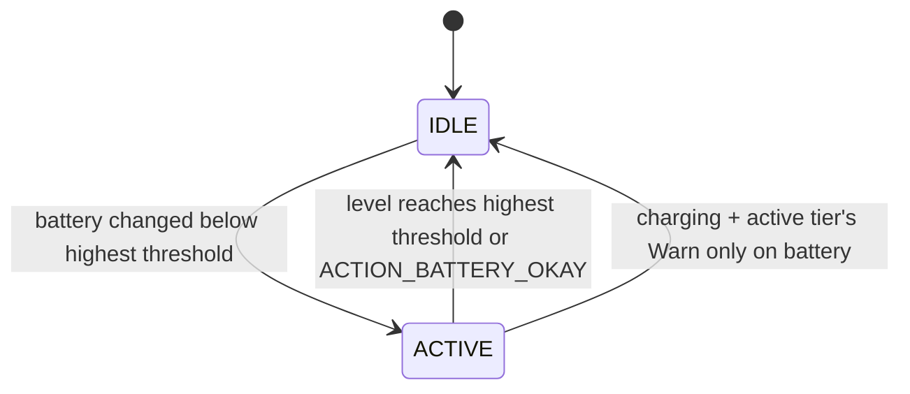
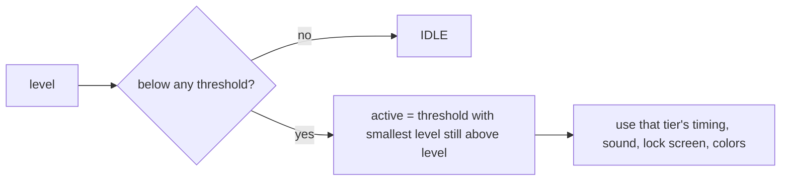

# Architecture

## Components

| Component | Responsibility |
| --- | --- |
| `MainActivity` | Dynamic threshold-list settings UI, live battery percentage, permissions, per-threshold sound picker and color palette |
| `BatteryMonitorService` | Foreground service, battery receiver, active-tier selection, notification and alert scheduling |
| `BootReceiver` | Starts the foreground service for `BOOT_COMPLETED` and `MY_PACKAGE_REPLACED` |
| `AppSettings` | SharedPreferences keys, defaults, threshold-list persistence, and settings accessors |
| `AlertThreshold` | Data class for one tier (level, name, timings, sound, flags, colors), JSON codec, and pure selection helpers |
| `OverlayAlert` | Bottom `TYPE_APPLICATION_OVERLAY` banner with auto/tap dismissal, tinted per threshold |
| `LockScreenAlertActivity` | Full-screen `showWhenLocked` warning above the keyguard; auto/tap dismissal; colored per threshold |
| `AboutActivity` | In-app legal screen: version, privacy statement, MIT license, third-party notices, and the full Apache-2.0 text |

## State flow

While ACTIVE, the tier is selected on every cycle:

`ACTION_BATTERY_CHANGED` is registered dynamically. It delivers the sticky
current value on registration and subsequent battery/plug-state changes.

## Alert scheduling

1. A battery event refreshes the foreground notification immediately.
2. If the level is below the highest threshold, the service enters the active
   tier ([activeThreshold]).
3. The banner is shown for the tier duration in the tier's colors.
4. When the banner closes, the service waits the tier interval.
5. The next cycle reads settings and battery level again.

`OverlayAlert` reports whether it successfully added its window and invokes a
single dismissal callback for either auto-dismiss or tap. Without overlay
permission, the notification remains the fallback and the interval starts from
the alert attempt.

While the device is locked with the display already on and the active
threshold's lock-screen flag is set, `LockScreenAlertActivity` is used instead
of the overlay (the overlay cannot show above the keyguard). It reports
dismissal back to the service through an in-app broadcast, so the same
interval rule applies. This path also requires the overlay permission, which is
what permits the background activity start (`BAL_ALLOW_SAW_PERMISSION`).

## Settings

Settings are stored in `battwarn_settings`:

| Key | Default | Meaning |
| --- | ---: | --- |
| `thresholds` | 20%/9% baseline | JSON list of user thresholds; each has `level`, `name`, `intervalSec`, `durationSec`, `soundUri`, `lockScreen`, `overrideSilentDnd`, `bgColor`, `fgColor`, `warnOnlyOnBattery` |

The fresh-install baseline is a 20% "Battery low" tier and a 9% "Battery
critical" tier, both silent, with lock-screen display on, warn-only-on-battery
on, and the default red background/white text. Legacy single-key settings are
ignored (no migration); when the stored list is empty the baseline is returned.

Intervals and durations accept values of one second or greater with no upper
cap. Levels are clamped to 0–100, must be unique, and are stored sorted by
level descending (most severe first). Colors are persisted as `#RRGGBB`
strings and parsed by the pure `parseHexColor` helper.

## Legal texts

The app is MIT-licensed, and the About screen shows the legal texts inside the
app. They are generated at build time, so each text has exactly one source in
the repo:

| Source | Generated raw resource | Shown as |
| --- | --- | --- |
| `LICENSE` | `mit_license.txt` | the app's MIT license |
| `NOTICE` | `third_party_notices.txt` | third-party attributions |
| `LICENSES/Apache-2.0.txt` | `apache_license_2_0.txt` | full Apache-2.0 text |

The Gradle `generateLegalResources` task copies the three files into
`build/generated/legal/res/raw`, which is added to the main resource set.
`AboutActivity` reads them with `openRawResource`. Every bundled runtime library
is Apache-2.0 (see `NOTICE`); build- and test-only dependencies are not
distributed.