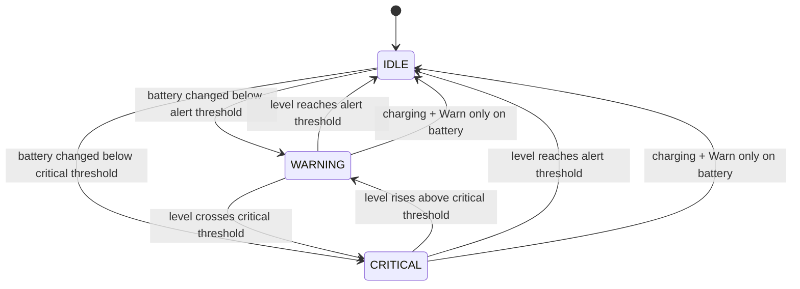

# Architecture

## Components

| Component | Responsibility |
| --- | --- |
| `MainActivity` | Compact settings UI, live battery percentage, permissions, sound picker |
| `BatteryMonitorService` | Foreground service, battery receiver, tier state machine, notification and alert scheduling |
| `BootReceiver` | Starts the foreground service for `BOOT_COMPLETED` and `MY_PACKAGE_REPLACED` |
| `AppSettings` | SharedPreferences keys, defaults, clamping, and persisted settings |
| `OverlayAlert` | Bottom `TYPE_APPLICATION_OVERLAY` banner with auto/tap dismissal |
| `LockScreenAlertActivity` | Full-screen `showWhenLocked` warning above the keyguard; auto/tap dismissal |

## State flow

`ACTION_BATTERY_CHANGED` is registered dynamically. It delivers the sticky
current value on registration and subsequent battery/plug-state changes.

## Alert scheduling

1. A battery event refreshes the foreground notification immediately.
2. If the level is below `alert_threshold`, the service enters an active tier.
3. The banner is shown for the tier duration.
4. When the banner closes, the service waits the tier interval.
5. The next cycle reads settings and battery level again.

`OverlayAlert` reports whether it successfully added its window and invokes a
single dismissal callback for either auto-dismiss or tap. Without overlay
permission, the notification remains the fallback and the interval starts from
the alert attempt.

While the device is locked with the display already on, `LockScreenAlertActivity`
is used instead of the overlay (the overlay cannot show above the keyguard). It
reports dismissal back to the service through an in-app broadcast, so the same
interval rule applies. This path also requires the overlay permission, which is
what permits the background activity start (`BAL_ALLOW_SAW_PERMISSION`).

## Settings

Settings are stored in `battwarn_settings`:

| Key | Default | Meaning |
| --- | ---: | --- |
| `alert_threshold` | 10 | Warning threshold, percent |
| `poll_interval_sec` | 25 | Warning quiet pause, seconds |
| `toast_duration_sec` | 5 | Warning banner duration, seconds |
| `critical_threshold` | 5 | Critical threshold, percent |
| `critical_interval_sec` | 15 | Critical quiet pause, seconds |
| `critical_duration_sec` | 5 | Critical banner duration, seconds |
| `critical_sound_uri` | empty | Picked notification sound; empty is silent |
| `warn_only_on_battery` | true | Suppress warnings while AC/USB/wireless charging |
| `override_silent_dnd` | false | Play critical sound in silent/vibrate/DND (alarm stream) |
| `lock_screen_alert` | true | Draw the alert full-screen over the lock screen (display already on) |

Intervals and durations accept values of one second or greater with no upper
cap. Critical threshold is always clamped to the alert threshold.
